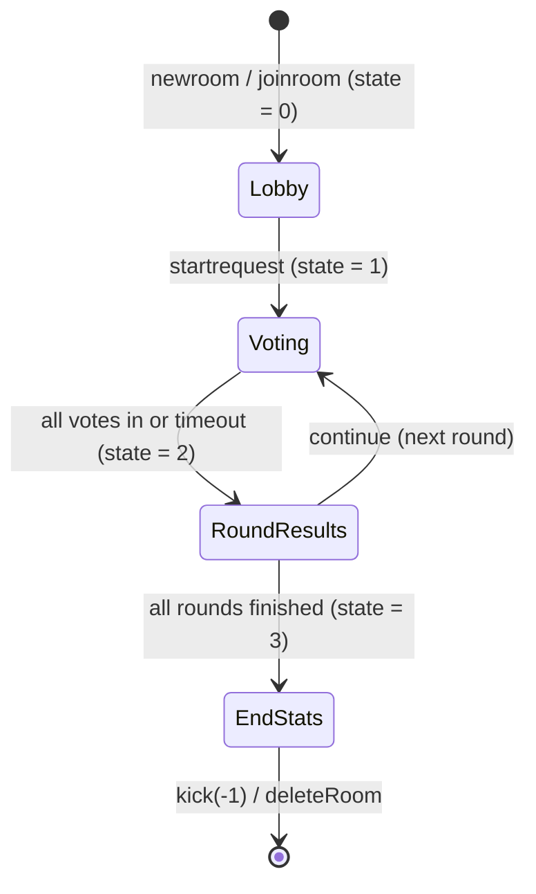

# Kto Pije? — Real-Time Multiplayer Web Party Game

A real-time multiplayer *"Most Likely To"* web party game built for mobile and desktop browsers. Powered by a **client–server architecture** with bidirectional **WebSocket (Socket.IO)** communication, room-based state management, and automatic session restoration across page reloads.

---

## Key Technical Highlights

- **Real-Time Communication (WebSockets):** Synchronizes room state, player lobbies, voting timers, and round results in real time over a single unified HTTP + Socket.IO server.
- **Room & Role Management (Host / Guest):** Generates unique 6-digit room codes, supports host-configurable game parameters (voting duration, round count, difficulty packs), player kicking, and clean room teardown.
- **Server-Authoritative Game State Machine:** Manages the full asynchronous game loop on the backend:
  `Lobby (0)` → `Timed Voting (1)` → `Round Results (2)` → `Final Scoreboard (3)`.
- **Session Persistence & Reconnection Handling:** Authenticates socket connections via custom `io.use` middleware using a 32-character client token stored in `localStorage`. Refreshing or briefly disconnecting automatically restores the player's room, host privileges, and active game phase.
- **In-Memory State & Resource Cleanup:** Tracks active rooms, sessions, votes, and scores using JavaScript `Map` structures, paired with a periodic background cleaner that evicts inactive rooms (10-minute AFK timeout).
- **Server-Side Validation & Security:** Enforces host-only actions, prevents duplicate nicknames and double voting, validates vote indices against room bounds, and escapes user-supplied names (`escapeHtml`) to mitigate XSS.
- **Lightweight Zero-Build SPA:** Dynamically swaps views from preloaded HTML templates (`public/pages.json`) with a responsive, mobile-first interface.

---

## Tech Stack

| Layer | Technologies |
| :--- | :--- |
| **Backend** | Node.js, Express 4, Socket.IO 4, built-in `http` & `fs` modules |
| **Frontend** | JavaScript (ES Modules), jQuery 3.7, Socket.IO Client, HTML5, CSS3 |
| **State Management** | Server-side in-memory `Map` stores + client `localStorage` |
| **Game Data** | Plain-text question banks across 3 difficulty tiers — 100 questions total (`easy.txt`, `mid.txt`, `hard.txt`) |

---

## Architecture & Game Flow



### Core Socket.IO Events

| Direction | Event | Description |
| :--- | :--- | :--- |
| Client → Server | `newroom` / `joinroom` | Creates a new room or joins an existing one by code with nickname validation |
| Client → Server | `startrequest` | Starts the game loop (host only) with chosen timer, round count, and question packs |
| Client → Server | `vote` | Submits a single validated vote during an active round |
| Client → Server | `continue` | Advances the room from the round results screen to the next question (host only) |
| Client → Server | `kick` | Leaves the room as a guest, kicks a player, or closes the room as host |
| Server → Client | `players-update` | Broadcasts the current participant list in the lobby |
| Server → Client | `question` / `time` | Emits the active question and periodic voting progress bar updates |
| Server → Client | `results` / `endresults` | Sends sorted per-round vote counts and final cumulative scores |

---

## Project Structure

```text
ktopije/
├── server.js           # Express HTTP server, Socket.IO handlers, game loop, and room lifecycle
├── package.json        # Project metadata, scripts, and dependencies
├── easy.txt            # Easy question pack (33 questions)
├── mid.txt             # Medium question pack (35 questions)
├── hard.txt            # Hard question pack (32 questions)
└── public/
    ├── index.html      # Main SPA shell document
    ├── client2.js      # Client logic, Socket.IO event listeners, and view rendering
    ├── pages.json      # HTML view templates (menu, lobby, voting, tutorial, end stats)
    ├── base2.css       # Responsive styles and CSS animations
    └── media/          # UI icons and visual assets
```

---

## Getting Started

### Prerequisites
- **Node.js** (v18+ recommended)
- **npm**

### Installation & Run

```bash
git clone <repository-url>
cd ktopije
npm install
npm start
```

By default, the server listens on port `8000` (configurable via the `PORT` environment variable):

```text
http://localhost:8000
```

Because static assets and Socket.IO share a single HTTP port, the game is also directly playable on mobile devices over a local network via `http://<host-local-ip>:8000`.
